<div align="center">

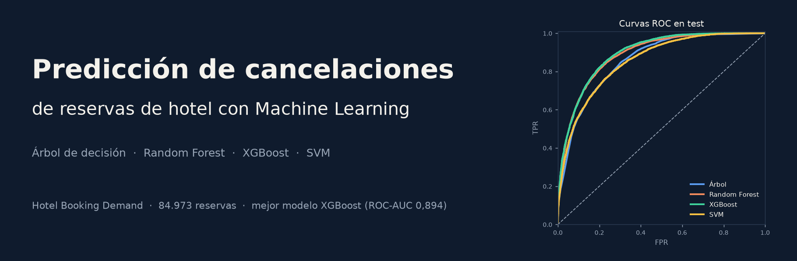

# Predicción de cancelaciones de reservas de hotel

**Clasificación binaria con Machine Learning: ¿esta reserva se va a cancelar?**


</div>

---

## Tabla de contenidos

- [Descripción](#descripción)
- [Resultados principales](#resultados-principales)
- [Dataset](#dataset)
- [Metodología](#metodología)
- [Modelos](#modelos)
- [Stack tecnológico](#stack-tecnológico)
- [Estructura del repositorio](#estructura-del-repositorio)
- [Instalación y uso](#instalación-y-uso)
- [Conclusiones](#conclusiones)
- [Disclaimer](#disclaimer)

---

## Descripción

Alrededor de un **37 % de las reservas** del dataset original terminan canceladas. Para un hotel esto significa habitaciones vacías, ingresos perdidos y políticas generales (overbooking, depósitos) que penalizan a todos los clientes por igual.

Este proyecto construye modelos que estiman, **para cada reserva**, la probabilidad de que sea cancelada, usando solo información disponible en el momento de reservar. Se comparan cuatro algoritmos con el mismo preprocesamiento y el mismo conjunto de test:

| # | Modelo | Rol |
|---|---|---|
| 1 | Árbol de decisión | Modelo base, interpretable |
| 2 | Random Forest | Ensemble por *bagging* |
| 3 | XGBoost | Ensemble por *boosting* |
| 4 | SVM (kernel RBF) | Modelo de márgenes, entrenado con muestra |

---

## Resultados principales

Evaluación sobre **21.244 reservas de test** (27,7 % canceladas), umbral de decisión 0,5:

| Modelo | Accuracy | Precision | Recall | **F1** | **ROC-AUC** | PR-AUC | Tiempo (s) |
|---|---:|---:|---:|---:|---:|---:|---:|
| 🥇 **XGBoost** (382 árboles) | 0,829 | 0,725 | **0,619** | **0,668** | **0,894** | **0,768** | 8,7 |
| 🥈 Random Forest (200 árboles) | **0,830** | **0,733** | 0,606 | 0,664 | 0,888 | 0,753 | 5,7 |
| 🥉 Árbol de decisión (prof. 10) | 0,806 | 0,684 | 0,562 | 0,617 | 0,858 | 0,686 | **0,3** |
| SVM RBF (muestra 10.000) | 0,809 | 0,722 | 0,506 | 0,595 | 0,854 | 0,702 | 14,8 |

> Referencia: predecir siempre "no cancela" da una accuracy de 0,723 y un recall de 0. Por eso se priorizan **F1** y **ROC-AUC**.

<p align="center">
  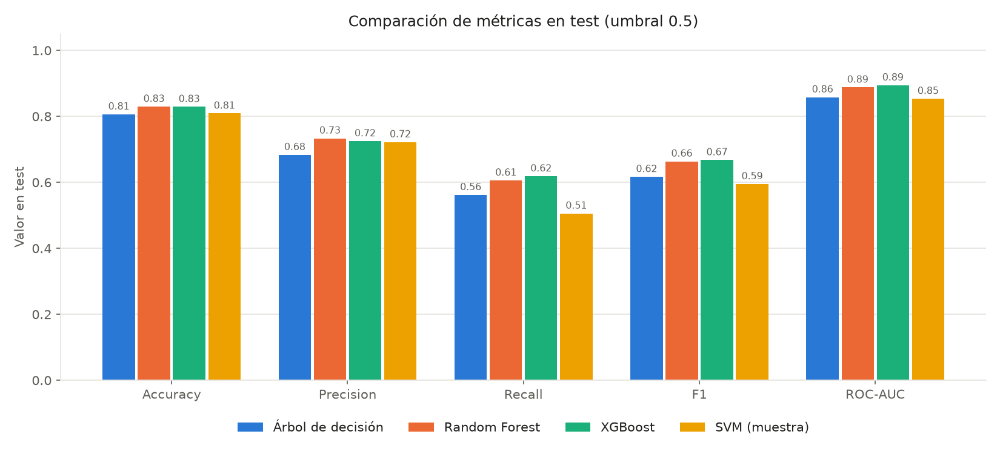
</p>

<p align="center">
  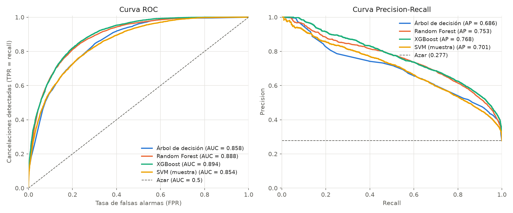
</p>

<p align="center">
  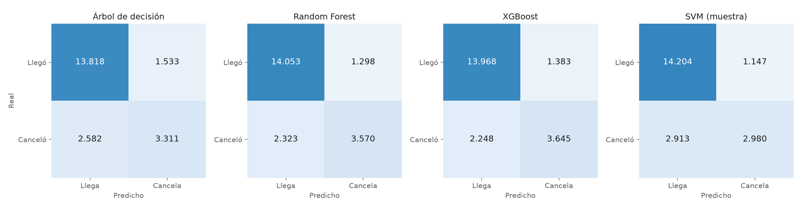
</p>

### Uso práctico: segmentación por riesgo (XGBoost)

| Riesgo predicho | Reservas | % del total | Tasa real de cancelación |
|---|---:|---:|---:|
| Bajo (< 0,3) | 13.335 | 62,8 % | 8,0 % |
| Medio (0,3 – 0,7) | 5.272 | 24,8 % | 49,7 % |
| Alto (> 0,7) | 2.637 | 12,4 % | **83,8 %** |

El modelo separa bien a los clientes: en el grupo de riesgo alto cancelan más de 8 de cada 10 reservas, mientras que en el de riesgo bajo solo 1 de cada 12.

---

## Dataset

**Hotel Booking Demand** — Antonio, Almeida y Nunes (2019), *Data in Brief*. Reservas de un hotel urbano (Lisboa) y uno resort (Algarve), Portugal, entre 2015 y 2017.

| | Original | Tras limpieza |
|---|---:|---:|
| Filas | 119.390 | **84.973** |
| Columnas | 32 | 27 (71 tras one-hot) |
| Tasa de cancelación | 37,0 % | 27,7 % |
| Train / Test | — | 63.729 / 21.244 (75/25 estratificado) |

<p align="center">
  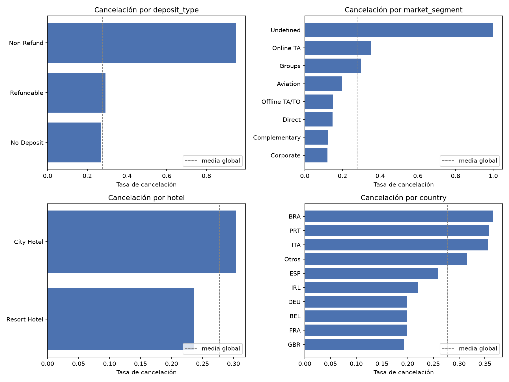
</p>

<p align="center">
  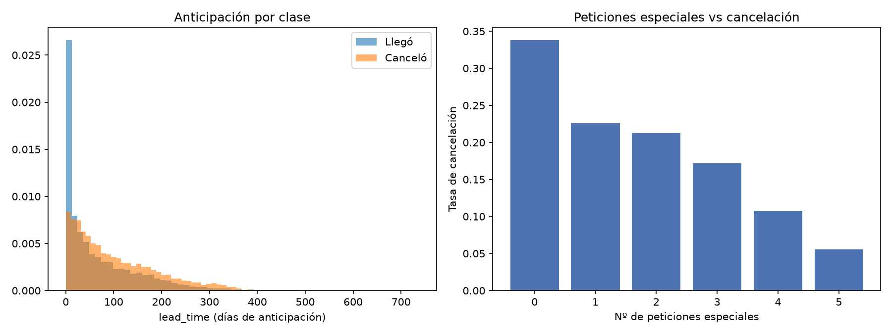
</p>

---

## Metodología

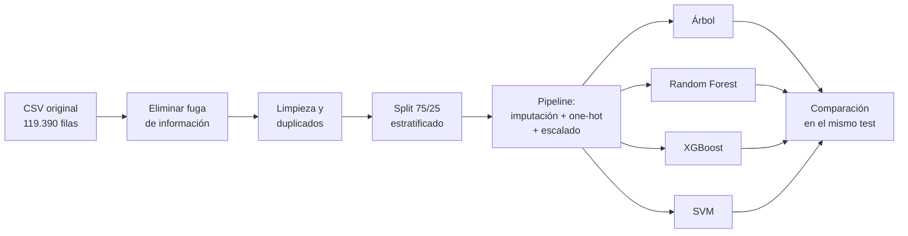

**Decisiones clave del preprocesamiento:**

- **Fuga de información eliminada.** Se quitan `reservation_status`, `reservation_status_date`, `assigned_room_type`, `booking_changes` y `days_in_waiting_list`, porque contienen o dependen del resultado final de la reserva.
- **Variables poco útiles o de alta cardinalidad.** `arrival_date_year` se elimina (no generaliza a años futuros); `agent` y `company` se convierten en indicadores binarios.
- **Duplicados eliminados.** El dataset no tiene identificador de cliente. Con duplicados, el 94,0 % de las filas duplicadas de test tenían una copia exacta en train (frente al 82,8 % esperado de forma natural), lo que inflaba las métricas. Se eliminan antes del split.
- **Un único `Pipeline`** de scikit-learn compartido por los cuatro modelos, ajustado solo con train para no filtrar información del test.

---

## Modelos

<details>
<summary><b>1. Árbol de decisión</b> — modelo base interpretable</summary>

Un árbol sin límite memoriza el entrenamiento (sobreajuste); se regulariza con `max_depth=10`. Sus reglas se pueden leer directamente.

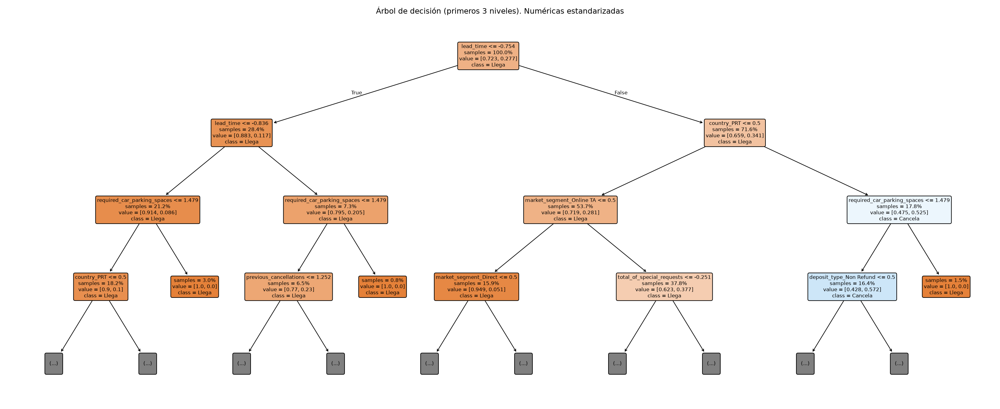
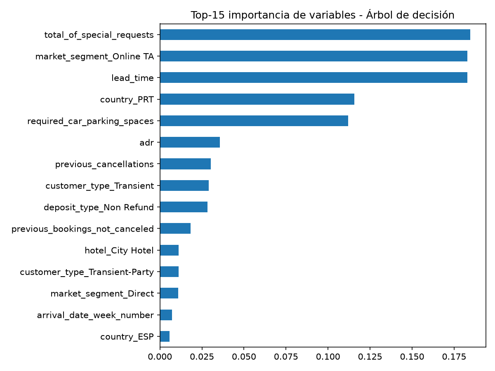
</details>

<details>
<summary><b>2. Random Forest</b> — bagging de 200 árboles</summary>

Promedia muchos árboles entrenados con muestras bootstrap y subconjuntos de variables, lo que reduce la varianza del árbol individual. Error *out-of-bag* como validación interna.

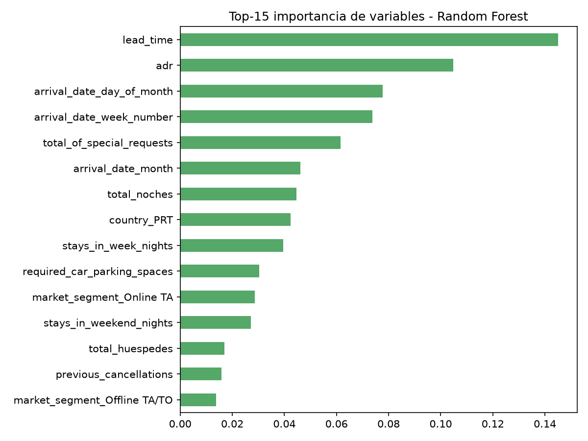
</details>

<details>
<summary><b>3. XGBoost</b> — boosting con early stopping</summary>

Cada árbol corrige los errores de los anteriores. El número de árboles (382) se elige con *early stopping* sobre un 15 % de validación separado del train.

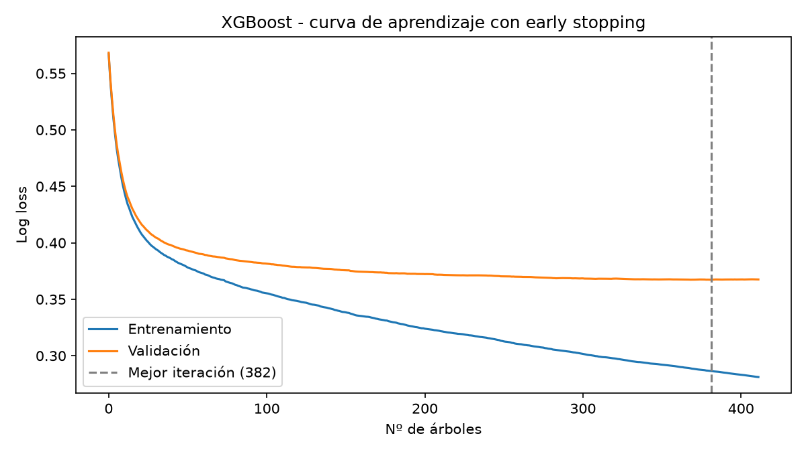
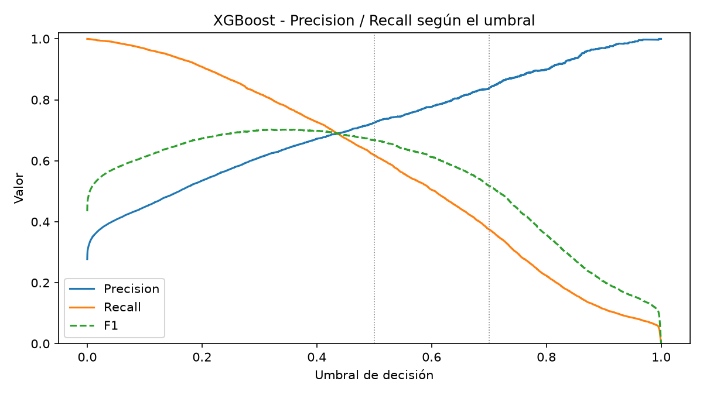
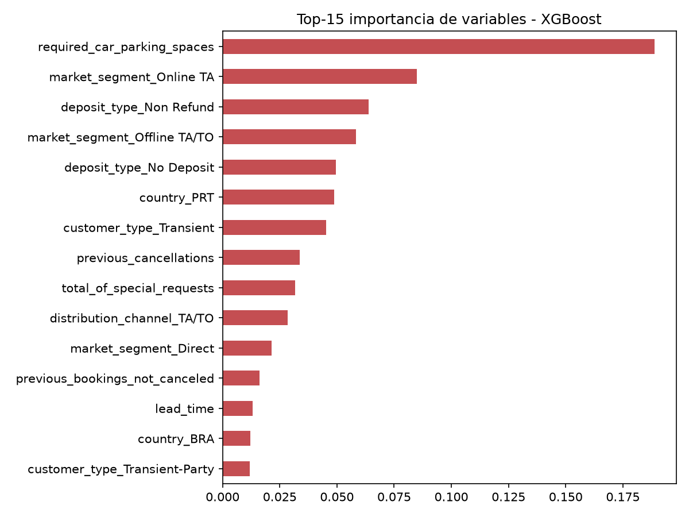
</details>

<details>
<summary><b>4. SVM (kernel RBF)</b> — entrenado con una muestra de 10.000</summary>

El coste de entrenamiento crece entre O(n²) y O(n³), así que se usa una muestra estratificada. `C` y `gamma` se ajustan con `GridSearchCV`; las probabilidades se calibran con Platt.

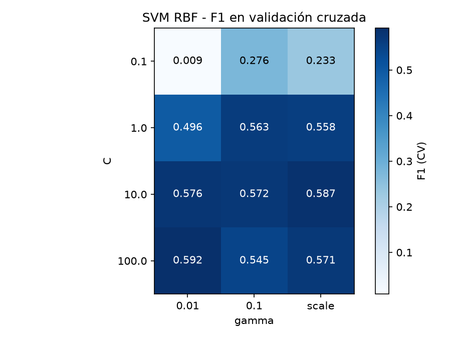
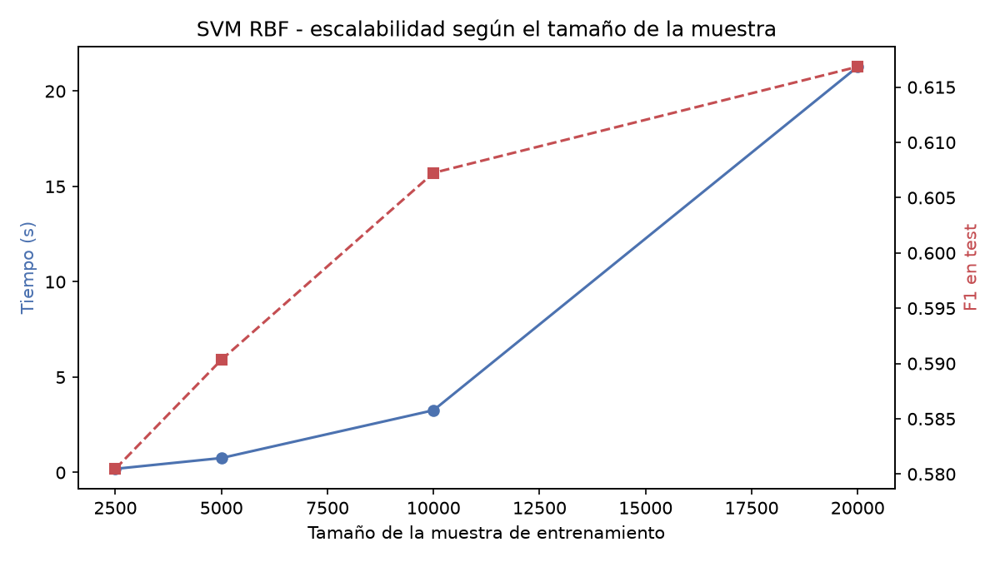
</details>

---

## Stack tecnológico

| Herramienta | Versión | Uso |
|---|---|---|
| Python | 3.12 | Lenguaje |
| pandas | 3.0 | Carga y manipulación de datos |
| NumPy | 2.5 | Cálculo numérico |
| scikit-learn | 1.9 | Pipeline, Árbol, Random Forest, SVM, métricas, validación cruzada |
| XGBoost | 3.4 | Gradient boosting |
| Matplotlib | 3.11 | Gráficas |

---

## Estructura del repositorio

```
hotel_booking_cancel_ml/
├── dataset/
│   └── hotel_bookings.csv        # Dataset original
├── preprocesamiento.py           # Carga, limpieza, split, Pipeline y evaluación comunes
├── eda.py                        # Análisis exploratorio
├── 01_arbol.py                   # Modelo 1: Árbol de decisión
├── 02_random_forest.py           # Modelo 2: Random Forest
├── 03_xgboost.py                 # Modelo 3: XGBoost
├── 04_svm.py                     # Modelo 4: SVM
├── comparacion.py                # Comparación final de los 4 modelos
├── resultados/                   # Gráficas y métricas generadas por cada script
│   ├── eda/
│   ├── arbol/
│   ├── random_forest/
│   ├── xgboost/
│   ├── svm/
│   └── comparacion/
├── docs/
│   └── portada.png
├── requirements.txt
└── README.md
```

---

## Instalación y uso

```bash
# 1. Clonar el repositorio
git clone https://github.com/nicosnz/hotel_booking_cancel_ml.git
cd hotel_booking_cancel_ml

# 2. Crear entorno virtual e instalar dependencias
python3 -m venv venv
source venv/bin/activate          # Windows: venv\Scripts\activate
pip install -r requirements.txt

# 3. Ejecutar en orden
python eda.py
python 01_arbol.py
python 02_random_forest.py
python 03_xgboost.py
python 04_svm.py
python comparacion.py
```

Cada script imprime sus métricas por consola y guarda las gráficas y resultados en `resultados/<modelo>/`. `comparacion.py` necesita que los cuatro modelos se hayan ejecutado antes.

---

## Conclusiones

1. **XGBoost es el mejor modelo** (F1 0,668; ROC-AUC 0,894), seguido muy de cerca por Random Forest.
2. **Los ensembles superan claramente al árbol individual** (+5 puntos de F1, +3 de ROC-AUC).
3. **El SVM no es adecuado para este problema**: su coste obliga a usar solo el 16 % de los datos, y aun con la misma muestra XGBoost lo supera.
4. **La accuracy no basta**: con un 27,7 % de cancelaciones, un modelo trivial ya alcanza 72,3 %.
5. **Variables clave** (coinciden entre modelos y con el EDA): anticipación (`lead_time`), plaza de parking, peticiones especiales, segmento Online TA, país Portugal y depósito Non Refund.
6. **El umbral se adapta al negocio**: bajarlo (≈ 0,3) para pedir garantías o contactar a clientes en riesgo; subirlo (≈ 0,7) para decisiones costosas como el overbooking.
7. **Limitaciones**: división train/test aleatoria (no temporal), umbrales explorados sobre el test y datos de solo 2 hoteles portugueses (2015–2017).

---

## Disclaimer

Proyecto con fines exclusivamente académicos; no constituye asesoramiento profesional. Usa el dataset público *Hotel Booking Demand* (Antonio, Almeida y Nunes, 2019), con datos de dos hoteles portugueses entre 2015 y 2017, por lo que sus resultados son válidos solo para ese contexto. En su elaboración se usó una herramienta de inteligencia artificial (Claude, de Anthropic) como apoyo; el autor revisó y asume la responsabilidad del contenido.

**Referencia:** Antonio, N., de Almeida, A., & Nunes, L. (2019). Hotel booking demand datasets. *Data in Brief*, 22, 41–49. https://doi.org/10.1016/j.dib.2018.11.126
